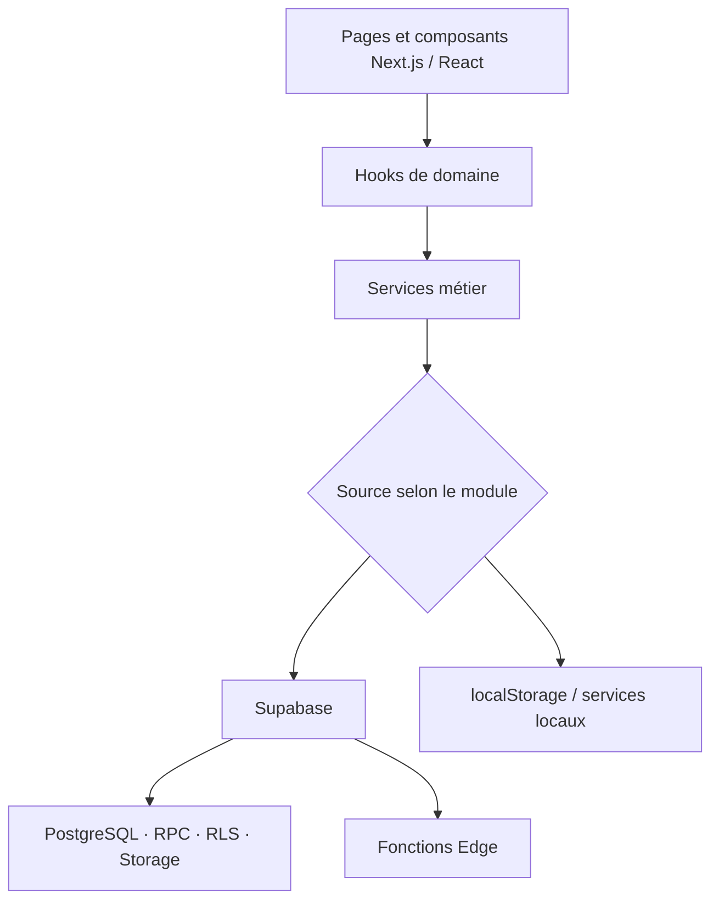

# Système Administratif Scolaire

<p align="center">
  <strong>APPLICATION DE GESTION ADMINISTRATIVE SCOLAIRE</strong><br>
  <em>Projet universitaire — Licence 3, Développement Web et Mobile</em>
</p>

<p align="center">
  <a href="https://syst-me-administratif-scolaire.vercel.app/">Application en ligne</a> ·
  <a href="https://github.com/darlyblake/Syst-me-Administratif-Scolaire/actions">GitHub Actions</a> ·
  <a href="./docs/ARCHITECTURE.md">Architecture</a> ·
  <a href="./docs/ROADMAP.md">Feuille de route</a> ·
  <a href="./docs/VALIDATION-TESTS.md">Bilan des tests</a>
</p>

---

## Présentation

Le **Système Administratif Scolaire** est une application web destinée à organiser les principales opérations administratives et pédagogiques d'un établissement : élèves, inscriptions, classes, personnel, présences, notes, paiements, documents et échanges avec les parents.

Le projet est développé dans le cadre d'une Licence 3 en Développement Web et Mobile. Il s'appuie sur des pages et composants React, des hooks, des services métier et plusieurs sources de données. **L'intégration de Supabase est déjà effective dans plusieurs domaines ; elle n'est pas une simple étape future.** Certains anciens parcours conservent toutefois un stockage local : la migration reste progressive et hybride.

> **État documentaire au 2 novembre 2026 :** les chiffres et constats techniques ci-dessous sont un instantané du dépôt `main` et du projet Supabase consultés à cette date. Ils peuvent évoluer. La présence d'un fichier ou d'une fonction ne prouve pas qu'un parcours a été testé en conditions réelles.

## Objectifs

| Axe | Objectif |
|---|---|
| Organisation | Structurer les informations scolaires et administratives |
| Suivi | Faciliter la consultation des élèves, classes, enseignants, présences et opérations financières |
| Communication | Améliorer l'accès des familles aux informations utiles |
| Traçabilité | Conserver l'historique des opérations et des modifications importantes |
| Sécurité | Contrôler les accès selon les utilisateurs, rôles et établissements |
| Évolutivité | Faire évoluer progressivement les modules et leurs services de données |

## Architecture générale actuelle



L'architecture n'est donc ni exclusivement locale ni entièrement centralisée dans Supabase. Les modules doivent être examinés individuellement avant d'affirmer quelle source de données ils utilisent.

Exemples observés dans le dépôt :
- Le registre d'appel actif utilise les services Supabase.
- Les parcours financiers actifs utilisent des services Supabase.
- Les pages de notes et de bulletins utilisent des services Supabase.
- La page administrative de documents utilise encore un service basé sur `localStorage`.
- Des services historiques locaux coexistent avec les services Supabase.

## Technologies principales

| Technologie | Rôle |
|---|---|
| Next.js 15 | Application web et routage |
| React 18 | Interface utilisateur |
| TypeScript 5.9 | Typage et structuration du code |
| Tailwind CSS 4.1 | Mise en forme |
| Supabase / PostgreSQL 17 | Authentification, données, fonctions et politiques d'accès |
| Jest | Tests automatisés présents dans le dépôt |
| Capacitor 8 | Structure de distribution mobile |
| Electron | Structure de distribution desktop |
| Vercel | Hébergement et déploiement web |

La présence de Capacitor ou d'Electron dans le projet ne signifie pas qu'une application mobile native ou un logiciel desktop finalisé a été livré.

## Instantané Supabase

Lors de la consultation en lecture seule du 2 novembre 2026, le projet Supabase présentait :

| Indicateur | Valeur observée |
|---|---:|
| Tables du schéma public | 87 |
| Tables publiques avec RLS activé | 87 |
| Politiques RLS publiques | 226 |
| Fonctions du schéma public | 232 |
| Déclencheurs PostgreSQL publics | 76 |
| Fonctions Edge actives | 12 |

Ces nombres décrivent la base à la date de consultation. Ils ne constituent ni un inventaire fonctionnel exhaustif ni une preuve que chaque politique et chaque fonction ont été testées.

## Sécurité : état et vigilance

La base active possède RLS sur les 87 tables publiques observées. L'application utilise aussi des mécanismes d'authentification, de rôles et de permissions. Des composants frontend tels que `PermissionRoute` participent au contrôle des parcours, mais le masquage d'une action dans l'interface ne remplace pas une autorisation côté base ou serveur.

Le dépôt consulté ne contient pas de fichier `middleware.ts` ni `proxy.ts`. Il ne faut donc pas décrire un middleware Next.js comme mécanisme global de protection des routes.

L'inspection Supabase a également fait ressortir des points à examiner : fonctions `SECURITY DEFINER`, cohérence de certaines permissions, tables sans politique RLS, politiques permissives multiples et configuration de protection contre les mots de passe compromis. Les détails figurent dans [l'architecture](./docs/ARCHITECTURE.md).

## Documentation

| Document | Objet |
|---|---|
| [Architecture technique](./docs/ARCHITECTURE.md) | Architecture hybride, données, sécurité, migrations et constats Supabase |
| [Feuille de route](./docs/ROADMAP.md) | Priorités de stabilisation, traçabilité, tests et améliorations |
| [Bilan des tests](./docs/VALIDATION-TESTS.md) | Distinction entre code présent, tests déclarés et vérifications restantes |
| [Plan Interface École](./IMPLEMENTATION-ECOLE.md) | État indicatif des domaines fonctionnels |
| [Plan Pointage](./POINTAGE-IMPLEMENTATION.md) | Fonctionnalités du pointage et tests à réaliser |
| [Checklist Parent](./PARENT-TODO.md) | Suivi détaillé des parcours du portail parent |
| [Règles pour les agents](./AGENTS.md) | Consignes de développement et de maintenance |

## Développement local

Consulter d'abord les scripts réellement déclarés dans `package.json`. Les commandes courantes du projet peuvent inclure :

```bash
npm install
npm run dev
npm run build
npm test
```

Ne lancer que les scripts présents dans la version locale. Un build réussi ne remplace pas les tests métier, les essais authentifiés ni les contrôles de sécurité.

## Règles de lecture des statuts

- **Présent dans le code** : une page, un service ou une fonction existe dans le dépôt.
- **Déployé** : un élément est présent dans l'environnement actif.
- **Testé** : un scénario précis a réellement été exécuté.
- **Validé** : le résultat attendu a été constaté et peut être documenté.
- **À vérifier** : le code existe, mais le test ou la preuve n'est pas disponible.

Ne pas déduire un statut de test à partir d'une simple case cochée dans une ancienne checklist.

---

<p align="center"><sub>Documentation du projet — mise à jour technique du 2 novembre 2026</sub></p>
