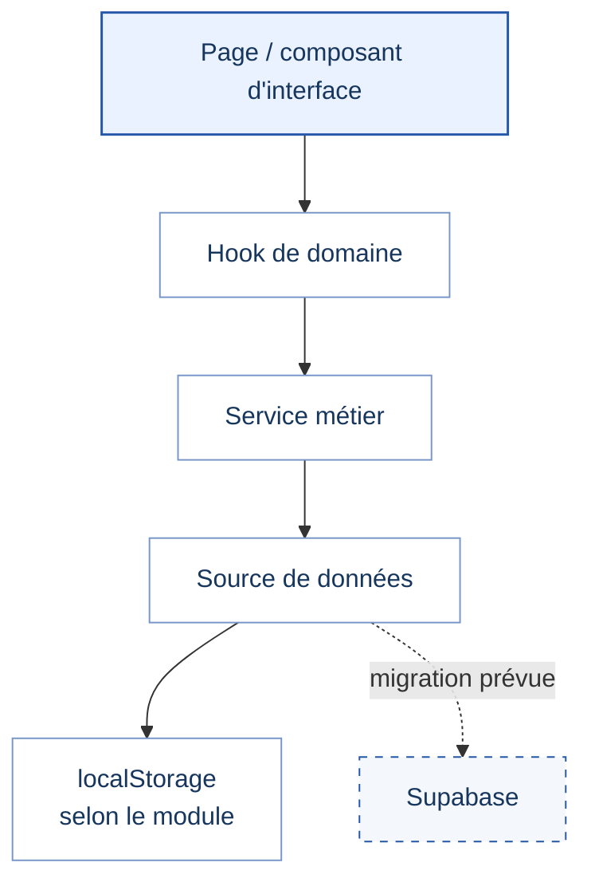

# Système Administratif Scolaire

<p align="center">
  <strong>APPLICATION DE GESTION ADMINISTRATIVE SCOLAIRE</strong><br>
  <em>Projet universitaire — Licence 3, Développement Web et Mobile</em>
</p>

<p align="center">
  <a href="https://syst-me-administratif-scolaire.vercel.app/">Application en ligne</a>
  &nbsp;·&nbsp;
  <a href="https://github.com/darlyblake/Syst-me-Administratif-Scolaire/actions">Intégration continue</a>
  &nbsp;·&nbsp;
  <a href="./docs/ARCHITECTURE.md">Architecture</a>
  &nbsp;·&nbsp;
  <a href="./docs/ROADMAP.md">Feuille de route</a>
  &nbsp;·&nbsp;
  <a href="./docs/VALIDATION-TESTS.md">Bilan des tests</a>
</p>

---

## Présentation du projet

Le **Système Administratif Scolaire** est une application conçue pour regrouper les principales opérations administratives d'un établissement dans une interface claire, cohérente et facile à utiliser. Le projet vise à simplifier le travail quotidien du personnel, à mieux organiser les informations et à faciliter leur consultation.

> **État technique documenté :** le projet est en phase de stabilisation du frontend et de la logique métier locale. Les modules et parcours doivent être validés individuellement avant de considérer l'ensemble de l'application comme prêt pour une utilisation complète en production.

## Objectifs

| Axe | Objectif |
|---|---|
| Organisation | Centraliser les informations scolaires et administratives utiles. |
| Suivi | Faciliter la consultation des élèves, enseignants, classes et opérations. |
| Expérience utilisateur | Proposer une interface sobre, lisible et adaptée aux tâches quotidiennes. |
| Évolutivité | Préparer une migration progressive vers une source de données centralisée. |
| Sécurité | Définir des rôles clairs et prévoir l'application des permissions côté serveur. |

## Architecture générale

La logique de développement sépare progressivement l'affichage, la gestion métier et l'accès aux données.



Pendant la phase actuelle, certains modules utilisent encore `localStorage`. La migration vers Supabase reste une étape distincte qui nécessitera un modèle de données, une authentification, des règles de sécurité et des tests dédiés.

## Technologies principales

| Technologie | Rôle dans le projet |
|---|---|
| Next.js 15 | Application web et routage |
| React 18 | Interface utilisateur |
| TypeScript | Typage du code |
| Tailwind CSS | Mise en forme de l'interface |
| Radix UI | Composants d'interface accessibles |
| React Hook Form et Zod | Gestion et validation des formulaires |
| Lucide React | Icônes |
| Jest | Tests automatisés, selon les suites disponibles |
| Capacitor / Electron | Pistes de distribution mobile et desktop |

## Rôles fonctionnels visés

| Rôle | Périmètre attendu |
|---|---|
| Administrateur d'établissement | Paramétrage et gestion générale dans les limites de ses droits |
| Comptabilité | Suivi des paiements et opérations financières autorisées |
| Secrétariat | Informations administratives nécessaires aux inscriptions et documents |
| Direction | Consultation des informations utiles au pilotage |
| Surveillance | Suivi de la présence et informations liées à la vie scolaire |

Ces rôles décrivent le modèle fonctionnel visé. **Masquer une action dans l'interface ne suffit pas à sécuriser les données** : les autorisations doivent aussi être contrôlées côté serveur ou base de données.

## Principes d'interface

La présentation recherchée est professionnelle et universitaire, avec une dominante bleu et blanc.

- Hiérarchie claire des titres et des informations.
- Tableaux pour comparer des données ; listes pour les éléments simples.
- Recherche, filtres et actions principales facilement repérables.
- Modales utilisées seulement lorsqu'elles simplifient une tâche.
- Espacements réguliers, contraste suffisant et affichage adapté aux petits écrans.
- Pas de cartes décoratives à répétition, de statistiques artificielles ni d'effets visuels inutiles.

## Documentation du projet

| Document | Contenu |
|---|---|
| [Architecture technique](./docs/ARCHITECTURE.md) | Couches applicatives, données, permissions et principes de conception |
| [Feuille de route](./docs/ROADMAP.md) | Étapes prévues, priorités et critères de progression |
| [Bilan des tests](./docs/VALIDATION-TESTS.md) | Résultats consultables, limites et vérifications restantes |
| [Règles pour les agents](./AGENTS.md) | Consignes de développement et de maintenance |

## Développement local

Les scripts disponibles doivent être confirmés dans le `package.json` de la version utilisée. Les commandes généralement prévues par le projet sont :

```bash
npm run dev
npm run lint
npm test
npm run build
```

Ne considérer une modification comme terminée qu'après avoir contrôlé le parcours concerné, les erreurs, les états de chargement, les formulaires, l'affichage responsive et les tests pertinents.

## Sécurité et évolution

Les prochaines étapes structurantes sont la stabilisation des modules, la définition du modèle de données, la migration progressive des services, puis la mise en place de l'authentification et des règles de sécurité. Les détails et l'ordre de ces étapes figurent dans la [feuille de route](./docs/ROADMAP.md).

---

<p align="center"><sub>Documentation du projet — Système Administratif Scolaire</sub></p>
