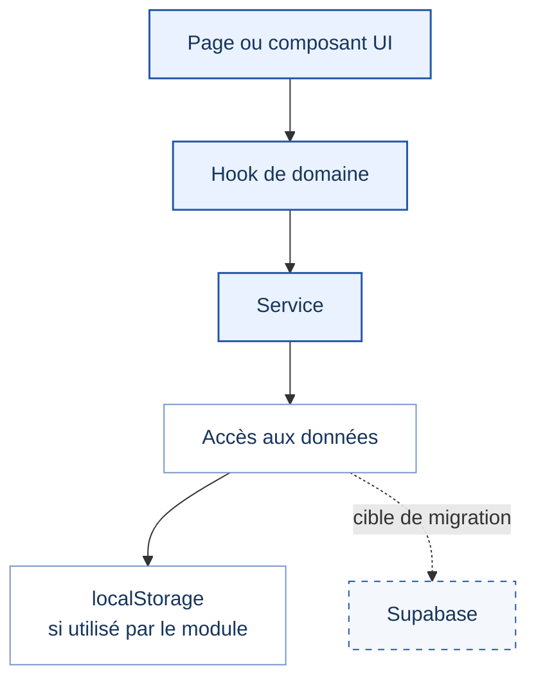
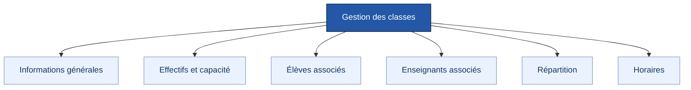
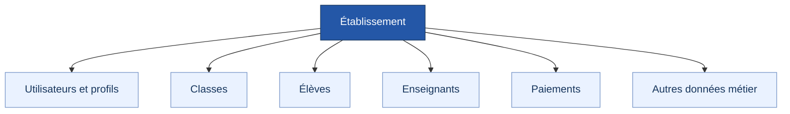
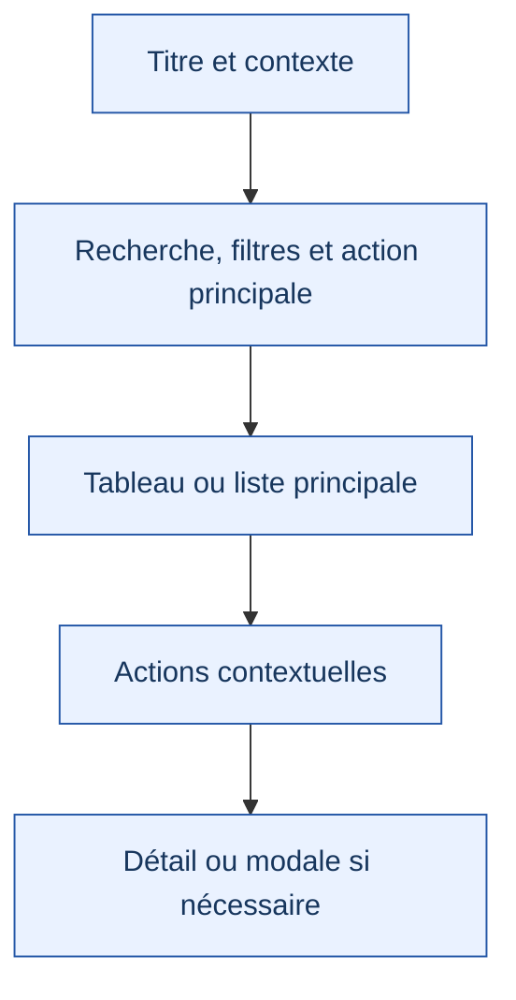
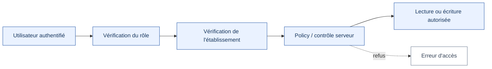

# Architecture technique

  <strong>SYSTÈME ADMINISTRATIF SCOLAIRE</strong> 
  <em>Document de référence technique</em>

---

## 1. Objet du document

Ce document décrit les principes d'organisation du code, la séparation des responsabilités, la gestion des données et les exigences à respecter au fil de l'évolution du Système Administratif Scolaire. Il sert de référence pour maintenir une architecture compréhensible et limiter les régressions lors des modifications.

> **État actuel :** les modules ne sont pas tous nécessairement au même niveau de maturité. Les usages de `localStorage` varient selon les fonctionnalités ; la migration vers Supabase est une étape future et doit être validée séparément.

## 2. Vue d'ensemble de l'architecture

| Couche | Responsabilité principale | À éviter |
|---|---|---|
| Page / interface | Afficher les informations et orchestrer les interactions | Accumuler toutes les règles métier |
| Hook de domaine | Coordonner chargement, état, mutations et données dérivées | Mélanger plusieurs domaines sans rapport |
| Service | Exposer des opérations de données cohérentes | Répéter la logique dans plusieurs composants |
| Source de données | Lire et enregistrer les informations | Faire confiance à des données non validées |

La séparation facilite les évolutions, mais ne signifie pas que tous les modules utilisent déjà exactement le même chemin. Chaque modification doit commencer par l'inspection du module concerné.

## 3. Pages et composants

Une page doit organiser le parcours utilisateur : contexte, recherche ou filtres, contenu principal et actions pertinentes. Les composants réutilisables doivent avoir une responsabilité claire : tableau, formulaire, filtre, fenêtre modale, détail ou état vide.

Avant d'extraire ou de fusionner un composant, vérifier ses usages, ses propriétés, les rôles qui l'utilisent et les comportements déjà attendus.

## 4. Hooks et services

### 4.1. Hooks

Un hook peut centraliser le chargement, la gestion des erreurs, les mutations, le rafraîchissement, les filtres et les données calculées nécessaires à l'interface. Il doit rester centré sur un domaine identifiable.

### 4.2. Services

Les services encapsulent les opérations sur les données afin que les composants ne dépendent pas directement des détails de stockage.

| Phase | Principe | Point de vigilance |
|---|---|---|
| Fonctionnement local | Utiliser `localStorage` dans les modules qui en dépendent actuellement | Contrôler les données absentes, mal formées ou anciennes |
| Migration future | Remplacer progressivement la source locale par Supabase | Conserver des contrats cohérents et tester les erreurs réseau |
| Mise en production | Utiliser des services sécurisés côté serveur lorsque nécessaire | Ne jamais exposer de secret serveur dans le navigateur |

## 5. Domaine « Classes »

Le domaine Classes regroupe des responsabilités liées qui doivent rester distinguables.

La page principale doit privilégier les opérations de gestion : recherche, filtres, tableau, création, modification, consultation et actions contextuelles. Les responsabilités liées peuvent collaborer sans être fusionnées dans un composant ou un hook monolithique.

## 6. Modèle multi-établissement visé

Ce schéma représente une cible d'architecture et non une affirmation selon laquelle toutes ces relations sont déjà implémentées. Chaque ressource concernée devra être rattachée à son établissement et son accès contrôlé côté serveur.

## 7. Rôles et permissions

| Rôle cible | Périmètre indicatif |
|---|---|
| Administrateur d'établissement | Paramétrage et gestion générale autorisée |
| Comptabilité | Paiements et données financières nécessaires |
| Secrétariat | Dossiers et documents administratifs nécessaires |
| Direction | Informations nécessaires au pilotage |
| Surveillance | Présence et suivi de la vie scolaire |

Le frontend peut masquer ou désactiver des actions pour améliorer l'expérience. L'autorisation effective doit être appliquée côté backend/base de données. Un utilisateur ne doit pas pouvoir accéder à un autre établissement en modifiant simplement un identifiant.

## 8. Structure d'interface recommandée

Les cartes sont pertinentes lorsqu'elles représentent une unité logique. Elles ne doivent pas être le composant par défaut de toutes les pages.

## 9. États d'interface à prévoir

| État | Comportement attendu |
|---|---|
| Chargement | Indiquer que les données sont en cours de récupération |
| Succès | Afficher les données ou confirmer l'action réalisée |
| Liste vide | Expliquer qu'aucun élément n'est encore enregistré |
| Aucun résultat | Indiquer que les filtres ne renvoient aucun élément |
| Erreur | Donner un message compréhensible et, si possible, une action de reprise |
| Mutation en cours | Empêcher les doubles soumissions et signaler l'attente |
| Confirmation | Demander une confirmation pour les actions sensibles ou difficiles à annuler |

## 10. Validation des données

Les formulaires doivent réutiliser les mécanismes de validation présents lorsqu'ils conviennent, notamment React Hook Form et Zod. Toute donnée provenant d'une source externe doit être vérifiée avant d'être considérée comme fiable.

Les règles de validation importantes doivent être cohérentes entre interface et serveur. La validation côté client améliore l'expérience mais ne remplace pas les contrôles côté serveur.

## 11. Performance et accessibilité

- Éviter les appels de service répétés à chaque rendu et les effets React inutiles.
- Ne charger que les données nécessaires au parcours.
- Prévoir pagination, filtrage ou virtualisation lorsque le volume le justifie.
- Utiliser des libellés explicites, un contraste suffisant et une navigation clavier cohérente.
- Ne pas transmettre une information uniquement par la couleur.
- Vérifier l'affichage sur écran étroit et à différentes tailles de texte.

## 12. Sécurité de la future intégration Supabase

La migration devra prévoir l'authentification, les rôles, l'isolation par établissement, les politiques RLS, la validation des mutations et la protection des données personnelles.

Ne jamais considérer une donnée comme protégée uniquement parce qu'elle est masquée dans l'interface. Les clés privées et secrets ne doivent jamais être placés dans le code client.

## 13. Principes d'évolution

1. Stabiliser les interfaces et la logique métier locale.
2. Vérifier les parcours fonctionnels et les erreurs.
3. Définir le modèle de données et les relations.
4. Migrer les services progressivement.
5. Mettre en place l'authentification, les rôles et les policies RLS.
6. Tester les scénarios multi-utilisateurs et multi-établissements.
7. Mettre à jour cette documentation après chaque changement d'architecture significatif.
