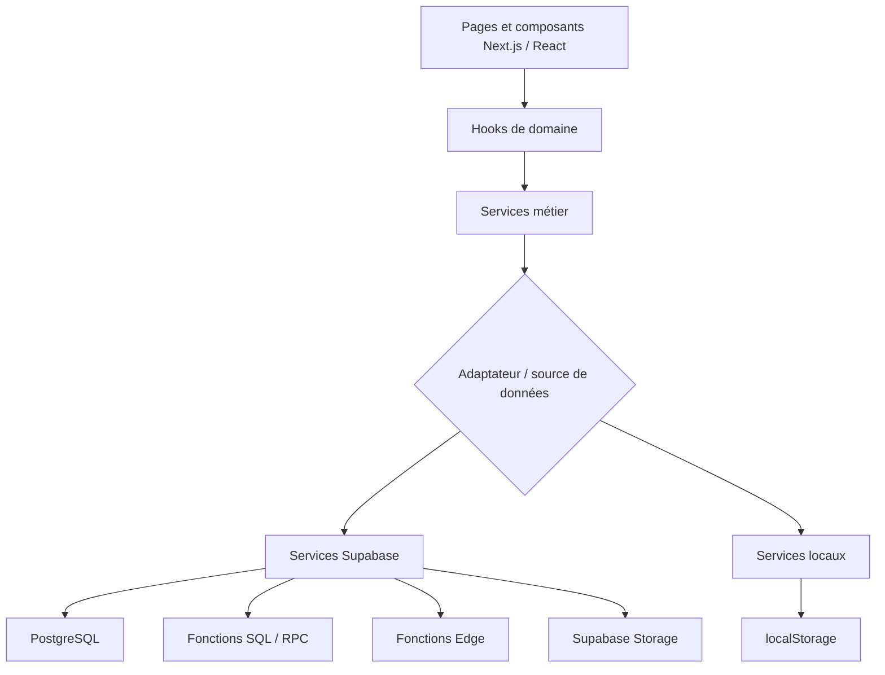

# Architecture technique

  <strong>UNIVERSITÉ NUMÉRIQUE DU GABON (UNG)</strong> 
  <em>Pôle STI · Licence 3 · Développement Web et Mobile</em> 
  <strong>DOCUMENT DE RÉFÉRENCE TECHNIQUE</strong>

  <a href="../README.md">Présentation</a> ·
  <a href="./ROADMAP.md">Feuille de route</a> ·
  <a href="./VALIDATION-TESTS.md">Bilan des tests</a>

> **Périmètre :** inspection en lecture seule du dépôt GitHub `darlyblake/Syst-me-Administratif-Scolaire`, branche `main`, commit `923563d05c0f363463f523bd00db70337afe0e67` (28 octobre 2026), et du projet Supabase actif, le 2 novembre 2026. Les constats sont datés et ne représentent pas des tests fonctionnels exhaustifs.

## 1. Vue d'ensemble

Le système suit une architecture hybride. Les pages et composants Next.js/React s'appuient sur des hooks et services métier. Selon le domaine, ces services communiquent avec Supabase ou utilisent encore un stockage local.

Cette architecture est progressive. Il ne faut pas affirmer que toutes les données sont centralisées dans Supabase ni que l'application fonctionne uniquement avec `localStorage`.

## 2. Technologies repérées

| Technologie | Rôle dans le projet |
|---|---|
| Next.js 15 | Application web, pages et routage |
| React 18 | Interface utilisateur |
| TypeScript 5.9 | Typage |
| Tailwind CSS 4.1 | Styles |
| Supabase | Authentification, accès aux données, fonctions et stockage |
| PostgreSQL 17 | Base relationnelle active |
| Jest | Suites de tests présentes |
| Capacitor 8 | Infrastructure de distribution mobile |
| Electron | Infrastructure de distribution desktop |
| Vercel | Déploiement web |

Les infrastructures Capacitor et Electron ne prouvent pas, à elles seules, la livraison d'applications natives ou desktop finalisées.

## 3. Couches applicatives

| Couche | Responsabilité |
|---|---|
| Pages et composants | Présentation, interactions et orchestration du parcours |
| Hooks | Chargement, état, mutations, filtres et rafraîchissement |
| Services métier | Opérations propres à un domaine fonctionnel |
| Services Supabase | Requêtes, mutations et appels RPC |
| PostgreSQL | Persistance, relations, contraintes, fonctions et triggers |
| RLS | Contrôle d'accès aux lignes selon le contexte de l'utilisateur |
| Fonctions Edge | Opérations backend déployées hors du navigateur |
| Services locaux | Persistance locale pour les domaines qui n'ont pas encore migré |

Le contrôle du rôle dans le frontend améliore le parcours utilisateur, mais ne constitue pas une frontière de sécurité suffisante. Les autorisations effectives doivent être contrôlées côté backend et base de données.

## 4. Répartition observée des sources de données

Exemples tirés des fichiers consultés dans le dépôt `main` :

| Domaine / parcours | Source observée | Remarque |
|---|---|---|
| Registre d'appel actif | Supabase | Utilise notamment les services de présence et les opérations d'enregistrement |
| Paiements / finance | Supabase | Services financiers et fonctions RPC |
| Notes et résultats | Supabase | Pages et services de notes / bulletins |
| Page administrative des documents | localStorage | Utilise encore `documents.service.ts` |
| Services historiques élèves, paiements, registre | Local selon les parcours | Coexistent avec des services Supabase plus récents |
| Portail parent | Supabase pour plusieurs domaines | Certaines fonctions et validations restent à compléter |

Avant de modifier un module, vérifier le chemin réellement utilisé par la page active. La présence d'un ancien service local ne prouve pas que la page actuelle l'appelle.

## 5. Modèle de données et instantané Supabase

Le projet Supabase consulté utilisait PostgreSQL 17. Les comptages observés dans le schéma public étaient :

| Élément | Nombre |
|---|---:|
| Tables publiques | 87 |
| Tables avec RLS activé | 87 |
| Politiques RLS | 226 |
| Fonctions publiques | 232 |
| Triggers publics | 76 |
| Fonctions Edge actives | 12 |

Les familles de données couvrent notamment les établissements, utilisateurs, rôles et permissions, élèves, responsables, inscriptions, classes, enseignants, matières, notes, présences, paiements, documents, notifications et opérations administratives.

Ces chiffres sont un instantané technique. Ils peuvent évoluer et ne remplacent pas le schéma détaillé ni une validation métier.

## 6. Authentification, rôles et contrôle d'accès

Le projet utilise Supabase Auth et un modèle de membres, rôles et permissions. Le frontend comprend notamment des contrôles de parcours tels que `PermissionRoute`.

Le dépôt consulté ne contient ni `middleware.ts` ni `proxy.ts`. La documentation ne doit donc pas attribuer à Next.js un middleware global de protection des routes.

Le modèle de sécurité doit être compris en plusieurs niveaux :
1. Authentifier l'utilisateur.
2. Déterminer son appartenance à l'établissement.
3. Contrôler le rôle et les permissions.
4. Appliquer les règles RLS aux opérations sur les données.
5. Encadrer les fonctions privilégiées et les opérations sensibles.

Le masquage d'un bouton n'empêche pas un utilisateur d'appeler directement une API. Les contrôles côté base restent essentiels.

## 7. Constats de sécurité Supabase

L'inspection des conseillers Supabase et des métadonnées SQL a fourni les constats suivants au 2 novembre 2026.

### 7.1 Fonctions privilégiées

- 185 fonctions publiques sont déclarées `SECURITY DEFINER`.
- 8 de ces fonctions sont exécutables par le rôle `anon`.
- 176 sont exécutables par `authenticated`.

Une fonction `SECURITY DEFINER` n'est pas automatiquement vulnérable. Il faut examiner individuellement son propriétaire, son `search_path`, ses contrôles d'identité, ses validations et les rôles autorisés à l'exécuter.

### 7.2 Permissions à harmoniser

Certaines politiques RLS utilisent notamment les permissions `settings.read`, `settings.manage`, `payments.read` et `finance.view`. La fonction versionnée `private.has_permission` consultée ne contient pas de correspondance par défaut pour tous ces noms, et aucune attribution correspondante n'a été relevée dans `establishment_role_permissions` pour les valeurs recherchées.

Il s'agit d'un risque de cohérence des autorisations pouvant provoquer des refus d'accès inattendus. L'effet réel doit être confirmé par des tests authentifiés avec chaque rôle concerné. Ne pas présenter ce constat comme une vulnérabilité d'accès confirmée.

### 7.3 Tables sans politique RLS

Quatre tables publiques avaient RLS activé mais aucune politique déclarée :
- `platform_admins`
- `student_transfer_requests`
- `support_messages`
- `support_requests`

Cela bloque les accès directs ordinaires via les politiques de ces tables. Il faut vérifier que les parcours nécessaires passent par les fonctions backend prévues et que leurs autorisations sont correctes.

### 7.4 Autres alertes de sécurité

- La protection Supabase contre les mots de passe compromis était désactivée au moment de la consultation.
- Les conseillers signalaient 137 cas de politiques permissives multiples à examiner.
- Les permissions des fonctions privilégiées doivent être revues.

Ces constats sont des points de contrôle, pas une preuve que des données ont été exposées.

## 8. Migrations : traçabilité et reproductibilité

La comparaison des fichiers SQL du dépôt avec l'historique des migrations Supabase a donné les résultats suivants :

| Indicateur | Valeur |
|---|---:|
| Fichiers SQL dans `supabase/migrations` | 91 |
| Préfixes de version distincts dans ces fichiers | 87 |
| Versions distinctes enregistrées dans Supabase | 228 |
| Versions présentes des deux côtés | 21 |
| Versions Supabase sans fichier portant le même numéro dans le dépôt | 207 |
| Préfixes du dépôt absents de l'historique Supabase consulté | 66 |

Quatre préfixes de version apparaissent plusieurs fois dans les fichiers du dépôt. Une migration peut avoir été renumérotée ou réécrite : la comparaison des numéros ne démontre donc pas, à elle seule, l'absence d'équivalence fonctionnelle.

**Conclusion :** l'historique SQL versionné dans le dépôt ne permet pas, à lui seul, de reproduire exactement l'état de la base active. Il faut réconcilier les migrations, documenter les écarts et éviter de modifier la base de production sur la seule base de cet inventaire.

## 9. Fonctions Edge : écart de versionnement

Supabase présentait 12 fonctions Edge actives. Le dépôt consulté contenait cinq dossiers sources de fonctions Edge :
- `claim-student`
- `create-establishment-super-admin`
- `create-platform-admin`
- `manage-school-user-account`
- `provision-parent-account`

Sept fonctions actives ne disposaient pas de source correspondante dans le dépôt consulté :
- `invite-establishment-member`
- `invite-school-user`
- `approve-establishment-request`
- `create-establishment-super-admin-v2`
- `unclaim-student`
- `manage-teacher-account`
- `get-parent-children`

La production n'est donc pas intégralement reproductible à partir des seules sources versionnées. Avant toute modification ou suppression de fonction, récupérer et versionner les sources manquantes, puis vérifier leurs dépendances et secrets sans les exposer.

## 10. Alertes de performance

Les conseillers Supabase ont signalé :

| Indicateur | Nombre |
|---|---:|
| Politiques permissives multiples | 137 |
| Index dupliqués | 9 |
| Clés étrangères sans index couvrant détecté | 53 |
| Politiques avec expression RLS susceptible d'être réévaluée par ligne | 26 |
| Index signalés comme inutilisés | 76 |

Ces alertes demandent une analyse. Elles ne prouvent pas automatiquement une lenteur observée. Ne pas supprimer les index dits inutilisés sans analyser les requêtes, la période d'observation et les besoins métier. Examiner les politiques avant de les fusionner, car leur combinaison peut modifier les autorisations.

## 11. Points de vigilance pour les services

- Vérifier si la page active appelle un service local ou Supabase.
- Ne jamais exposer la clé `service_role` dans le navigateur.
- Valider les entrées côté serveur, même si les formulaires utilisent Zod.
- Garder les opérations financières et les mutations critiques atomiques.
- Contrôler l'appartenance à l'établissement pour chaque ressource.
- Ne pas déduire qu'un test est réussi à partir d'une compilation ou d'une réponse HTTP 200.
- Conserver les données historiques et tracer les corrections sensibles.

## 12. Règles d'évolution

1. Identifier le parcours actif et son service avant toute modification.
2. Documenter les contrats de données et les dépendances.
3. Réconcilier l'historique des migrations avant de prétendre pouvoir reconstruire la production.
4. Versionner les fonctions Edge manquantes après revue de sécurité.
5. Harmoniser les permissions entre le frontend, les rôles et les politiques RLS.
6. Tester avec plusieurs rôles et plusieurs établissements.
7. Mettre à jour cette documentation avec la date, le commit et la portée réelle des contrôles.

---

*Instantané technique établi le 2 novembre 2026. Les données de production et le dépôt peuvent changer après cette date.*
