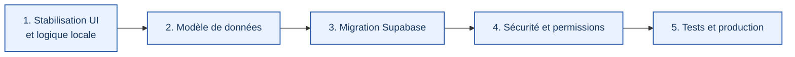
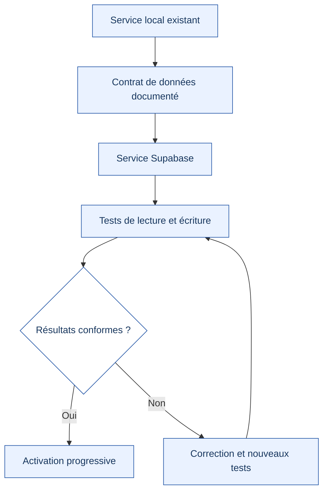
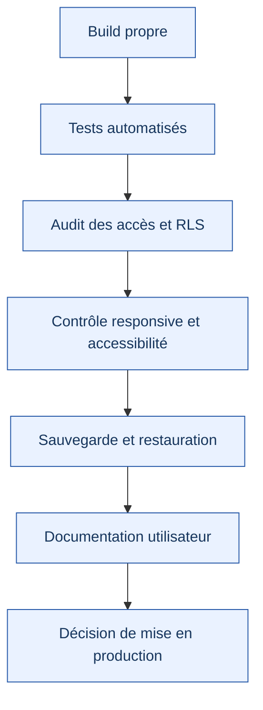

# Feuille de route du projet

  <strong>SYSTÈME ADMINISTRATIF SCOLAIRE</strong> 
  <em>Plan de progression et critères de validation</em>

---

## Vue d'ensemble

La feuille de route distingue la stabilisation de l'interface et de la logique locale de la migration vers un backend sécurisé. Une étape ne doit être considérée comme achevée que lorsque ses critères ont été contrôlés.

## Phase 1 — Stabilisation du frontend et de la logique locale

**Objectif :** obtenir des parcours cohérents avant d'introduire une migration backend plus large.

| Travail | État de suivi | Critère de sortie |
|---|---|---|
| Définir les règles globales et documenter l'architecture | Réalisé selon la documentation du dépôt | Les règles sont accessibles et cohérentes |
| Finaliser les modules frontend | À faire | Les parcours principaux sont testés |
| Harmoniser hooks et services | À faire | Responsabilités identifiées et dépendances maîtrisées |
| Nettoyer les composants obsolètes ou doublons | À faire | Aucun retrait sans vérification des usages |
| Contrôler création, modification et suppression | À faire | Cas nominal et erreurs testés |
| Vérifier les états de chargement, vide et erreur | À faire | Chaque parcours présente un retour compréhensible |
| Vérifier responsive et accessibilité | À faire | Contrôle sur plusieurs tailles et navigation clavier |
| Stabiliser tests et build | En cours de validation | Les commandes et tests pertinents sont exécutés et consignés |

Les états ci-dessus sont un suivi documentaire, pas un résultat de test automatique.

## Phase 2 — Définition du modèle de données

Avant de créer ou de migrer la base, définir :

- les entités et leurs champs ;
- les relations et clés étrangères ;
- les identifiants stables ;
- l'appartenance de chaque ressource à un établissement ;
- les rôles et permissions ;
- les contraintes d'intégrité ;
- les données personnelles ou sensibles ;
- les règles d'archivage et de suppression ;
- les règles de sauvegarde et de restauration.

**Critère de sortie :** un modèle documenté, relu et compatible avec les besoins des modules existants.

## Phase 3 — Migration progressive vers Supabase

La migration doit se faire domaine par domaine, plutôt que par une réécriture globale.

Ordre de migration proposé :

1. Authentification et profils.
2. Établissements et utilisateurs.
3. Élèves et enseignants.
4. Classes et relations scolaires.
5. Modules administratifs.
6. Données financières et autres domaines métier selon les dépendances.

Cet ordre pourra être ajusté après inspection du modèle réel et des dépendances entre modules.

## Phase 4 — Sécurité et permissions

| Contrôle | Résultat attendu |
|---|---|
| Authentification | Les ressources protégées nécessitent une session valide |
| Rôles | Chaque action est autorisée selon les droits effectifs |
| Isolation des établissements | Un utilisateur ne lit ni ne modifie les données d'un autre établissement |
| RLS | Les politiques couvrent les opérations et les tables concernées |
| Validation serveur | Les données sont contrôlées au-delà du formulaire client |
| Secrets | Aucune clé privée ni secret serveur dans le navigateur |
| Opérations sensibles | Les actions importantes sont journalisées ou confirmées lorsque nécessaire |

**Test essentiel :** vérifier explicitement qu'un utilisateur de l'établissement A ne peut pas lire ou modifier les ressources de l'établissement B, y compris en changeant un identifiant dans une requête.

## Phase 5 — Tests de migration

Pour chaque domaine migré :

- tester les lectures et écritures normales ;
- tester les données absentes, invalides et les erreurs réseau ;
- vérifier les relations et les contraintes ;
- vérifier les droits avec plusieurs rôles ;
- comparer les résultats avant et après migration ;
- documenter les écarts et les corrections ;
- prévoir une procédure de retour arrière adaptée.

## Phase 6 — Préparation à la production

| Domaine | Vérification avant production |
|---|---|
| Compilation | Build propre sur la version cible |
| Qualité | Tests et contrôles statiques exécutés, résultats examinés |
| Sécurité | Rôles, accès et politiques de données testés |
| Expérience | Responsive, accessibilité et messages d'erreur vérifiés |
| Exploitation | Sauvegarde, restauration et procédure d'incident documentées |
| Documentation | Guide utilisateur et documentation technique à jour |

## Règle de suivi

Mettre à jour cette feuille de route à chaque jalon. Ne marquer une tâche comme terminée que lorsque le résultat est observable et, lorsque c'est possible, accompagné d'un test ou d'une preuve. Les statuts doivent refléter l'état réel du dépôt, pas une intention.
