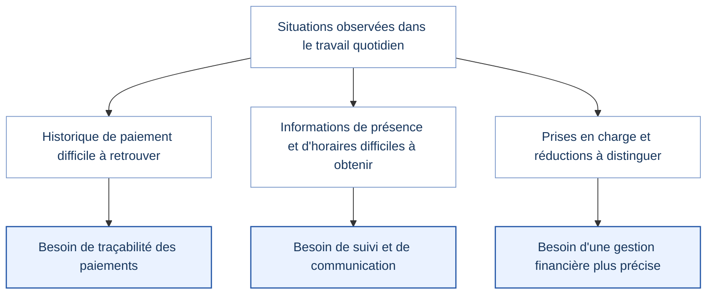
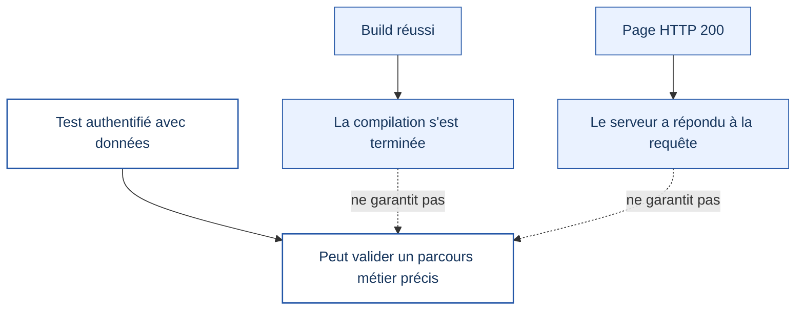
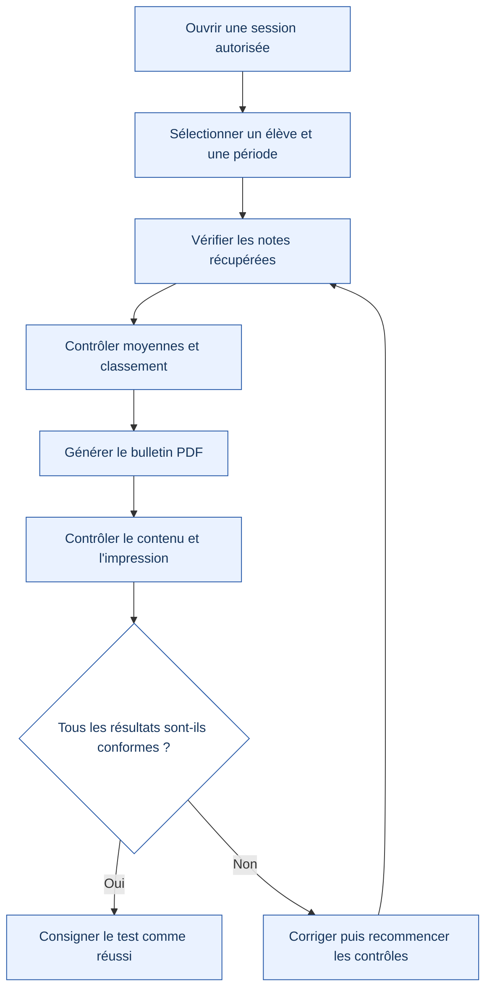

# Bilan des tests de mon système administratif scolaire

  <strong>UNIVERSITÉ NUMÉRIQUE DU GABON (UNG)</strong> 
  <em>Pôle STI — Licence 3 — Développement Web et Mobile</em> 
  <strong>Dossier de validation du projet</strong>

---

| Information | Détail |
|---|---|
| **Projet** | Système Administratif Scolaire |
| **Étudiant** | MOUEMBANZA LOUNDOU Darly Freid |
| **Formation** | Licence 3 — Développement Web et Mobile, pôle STI |
| **Établissement de formation** | Université Numérique du Gabon (UNG) |
| **Date de mise à jour** | 28 octobre 2026 |

## Synthèse de l'état des vérifications

| Domaine | État déclaré | Précision |
|---|---|---|
| Registre d'appel | Tests déclarés réussis | Valide le périmètre effectivement testé |
| Notes et résultats | Vérification complémentaire requise | Les dernières modifications des bulletins doivent être retestées |
| Compilation automatisée | Réussie selon le résultat consulté | Ne valide pas à elle seule le fonctionnement métier |
| Déploiement | Indiqué comme prêt | Les parcours authentifiés restent à vérifier |
| Documents et PDF | Contrôle complémentaire requis | Vérifier les données, le rendu et l'impression |
| TypeScript et ESLint | Non confirmés dans ce bilan | Les contrôles doivent être exécutés séparément |

> **À retenir :** la compilation et la mise en ligne ne prouvent pas que tous les parcours fonctionnels sont validés. Les statuts ci-dessous distinguent les résultats consultés, les tests déclarés terminés et les essais qui restent à effectuer.

## 1. Pourquoi j'ai réalisé ce projet

L'idée de ce projet est née de mon expérience professionnelle au Complexe Scolaire La Réussite d'Owendo, où je travaille comme informaticien. Dans le cadre de mon activité et de mon passage au secrétariat, j'ai pu observer certaines situations qui m'ont amené à réfléchir à la manière dont les informations administratives et scolaires sont suivies et communiquées aux familles. Je me suis alors demandé comment une application informatique pourrait contribuer à faciliter ce travail.

Un des sujets qui m'a particulièrement fait réfléchir concerne le suivi des paiements. Il peut arriver qu'un parent pense avoir déjà réglé un mois de scolarité, mais qu'il ne retrouve plus le reçu papier qui lui permettrait de justifier le paiement. Le reçu est une preuve utile, mais comme tout document papier, il peut être égaré. Lorsqu'il n'est pas possible de retrouver rapidement l'information correspondante, il devient plus difficile de vérifier l'historique et de répondre clairement aux questions. Ce constat m'a donné envie de réfléchir à un suivi des paiements dans lequel les informations sont enregistrées et peuvent être consultées plus facilement, sans faire reposer toute la vérification sur la conservation du reçu par le parent.

Je me suis également intéressé au suivi de la présence des élèves et à la circulation de l'information entre l'école et les familles. Il arrive que des parents appellent pour savoir si leur enfant est en cours, puis découvrent que les cours n'ont pas eu lieu ou qu'ils sont terminés depuis un certain temps. Ces situations m'ont fait comprendre qu'il serait utile de faciliter l'accès aux informations concernant la présence et les horaires des élèves, afin que les familles puissent mieux comprendre la situation scolaire de leur enfant.

Je partage ces observations pour expliquer l'origine de ma réflexion, et non pour mettre en cause l'école, ses agents ou les parents. Elles correspondent à des besoins que j'ai rencontrés dans mon environnement professionnel et qui m'ont donné envie de proposer une solution informatique adaptée. Mon objectif est de contribuer à améliorer le suivi et la disponibilité des informations, tout en tenant compte de la réalité du travail quotidien dans un établissement scolaire.

Au cours de la conception, j'ai aussi réfléchi à la gestion des différentes prises en charge des frais scolaires. Les situations ne se résument pas toujours à un paiement intégral par les parents : certains organismes peuvent financer une partie des frais et certaines familles peuvent bénéficier de réductions, par exemple en fonction du nombre d'enfants scolarisés. Il me paraît donc important de pouvoir distinguer les montants payés par les familles, les sommes prises en charge par les organismes et les éventuelles réductions accordées.

C'est à partir de ces observations que j'ai orienté mon projet vers un système administratif scolaire. Je souhaite qu'il contribue à mieux organiser les informations, à faciliter le suivi des paiements et des absences, et à rendre les données utiles plus faciles à retrouver. Je sais qu'une application ne peut pas, à elle seule, résoudre toutes les difficultés d'organisation ou de communication. Elle peut cependant apporter une aide si elle répond aux besoins réels et si les informations qu'elle contient sont correctement mises à jour.

### De l'observation au besoin fonctionnel

## 2. Objectif des tests

Au fur et à mesure du développement, j'ai effectué des vérifications pour voir si les principales fonctionnalités se comportaient comme prévu. Pour moi, les tests sont importants : une page qui s'affiche correctement ne garantit pas, à elle seule, que les calculs, les données enregistrées ou les documents produits sont justes.

Dans ce bilan, je distingue donc les tests fonctionnels déjà déclarés terminés, les vérifications techniques que j'ai pu consulter et les essais qu'il me reste à réaliser. Je préfère signaler clairement les points qui restent à vérifier plutôt que de présenter toute l'application comme entièrement validée.

## 3. Tests fonctionnels réalisés

### 3.1. Registre d'appel

J'ai réalisé les tests fonctionnels du registre d'appel. Les tests effectués sur ce module ont été déclarés réussis. Cela valide le fonctionnement du module dans le périmètre qui a été testé, sans prétendre couvrir toutes les situations possibles.

### 3.2. Notes et résultats

J'ai également travaillé sur le module de gestion des notes et des résultats. Les tests fonctionnels antérieurs de ce module avaient été déclarés terminés. Toutefois, j'ai ensuite apporté des modifications à la récupération des notes et à la génération des bulletins. Je dois donc reprendre les vérifications de ce parcours avec une session authentifiée et des données réelles : récupération des notes, calcul des moyennes, classement des élèves et production du bulletin PDF.

Tant que ces derniers contrôles ne sont pas terminés, je ne considère pas les nouvelles modifications des bulletins comme entièrement validées.

## 4. Vérifications techniques de la mise en ligne

J'ai consulté les résultats disponibles pour la compilation automatisée et la mise en ligne de l'application. La compilation Next.js exécutée par GitHub Actions s'est terminée avec succès, et le déploiement Vercel de la branche principale est indiqué comme prêt. Les pages Notes/Bulletins et Documents ont également répondu avec le code HTTP 200 lors du contrôle public.

Ces résultats sont encourageants : ils montrent que la compilation et la mise en ligne se sont déroulées correctement. Ils ne prouvent cependant pas que toutes les fonctionnalités fonctionnent avec un compte connecté et les données réelles de l'établissement. La configuration actuelle de compilation ne vérifie pas non plus automatiquement les erreurs TypeScript ni ESLint.

### Ce que prouve chaque contrôle

## 5. Vérifications qu'il me reste à effectuer

| N° | Contrôle à réaliser | Méthode de vérification | État |
|---:|---|---|---|
| 1 | Accès au module des bulletins | Ouvrir une session autorisée et sélectionner un élève réel | À faire |
| 2 | Récupération des notes | Comparer les notes affichées aux données de référence | À faire |
| 3 | Moyennes sur 20 | Recalculer quelques moyennes manuellement et comparer | À faire |
| 4 | Classements | Comparer les rangs calculés avec les résultats de référence | À faire |
| 5 | Bulletin PDF | Générer un bulletin et contrôler contenu, mise en page et impression | À faire |
| 6 | Documents administratifs | Contrôler nom, classe, année scolaire, dates et établissement | À faire |
| 7 | Qualité du code | Exécuter TypeScript et ESLint séparément, puis examiner les erreurs | À faire |

### Parcours de validation des bulletins

## 6. Mon bilan

Ces vérifications m'ont permis de mieux suivre l'état d'avancement de mon application. À ce stade, les tests du registre d'appel ont été déclarés réussis, les tests fonctionnels antérieurs du module Notes et résultats ont été déclarés terminés, et les résultats techniques disponibles confirment que la compilation et le déploiement ont abouti.

Il me reste à terminer les essais liés aux dernières modifications des bulletins et des documents administratifs. Je veux notamment m'assurer que les données affichées, les calculs et les fichiers produits correspondent bien aux informations de l'application. Je ne présenterai ces points comme validés qu'après avoir réalisé et contrôlé les essais nécessaires.

Ce projet m'a permis de partir de besoins que j'ai observés dans mon environnement professionnel pour réfléchir à des fonctionnalités concrètes. Il m'a aussi rappelé qu'un outil de gestion doit rendre les informations plus faciles à retrouver et à vérifier, tout en restant adapté aux habitudes et aux contraintes des personnes qui l'utilisent. Au-delà de l'interface, je dois donc veiller à la cohérence des données, à la fiabilité des calculs et à la qualité des documents générés.

## 7. Références techniques

| Ressource | Utilité |
|---|---|
| [Dépôt GitHub](https://github.com/darlyblake/Syst-me-Administratif-Scolaire) | Code source et historique des modifications |
| [Commit des fonctionnalités](https://github.com/darlyblake/Syst-me-Administratif-Scolaire/commit/bceb5798cf15bffdca98e10cd92538380074e88b) | Référence des modifications fonctionnelles précédemment citées |
| [Exécution GitHub Actions](https://github.com/darlyblake/Syst-me-Administratif-Scolaire/actions/runs/40703995888) | Résultat de compilation consulté |
| [Application en ligne](https://syst-me-administratif-scolaire.vercel.app/) | Accès public à l'application |

---

*Remarque méthodologique : ce bilan distingue les tests fonctionnels déclarés terminés, les résultats techniques consultables et les essais complémentaires qui restent à effectuer. Il ne remplace pas les comptes rendus détaillés de tests lorsqu'ils sont disponibles.*
